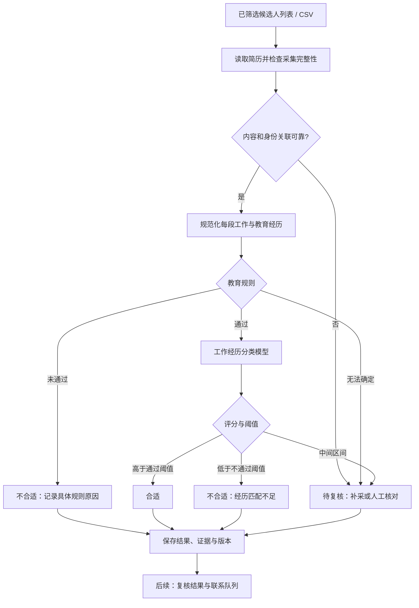

# 简历二次筛选可行性方案

版本：V1.0｜日期：2026-10-21｜状态：设计方案，尚未训练或验证模型

## 1. 建议与实施范围

技术上可行。采用「学校名单规则 + 工作经历二分类」：程序判断教育条件，模型学习工作经历是否符合目标岗位，最后合并结果。姓名保留用于结果关联，不进入模型特征。

第一阶段交付本地批量筛选工具：输入已提取的 CSV，输出每位候选人的规则结果、工作经历评分和合适/不合适标签。先用离线数据验证效果，再接入 Agent 浏览简历。后续发送招呼使用单独队列和状态记录。

首版限定一个目标岗位及一个固定岗位要求版本。换岗位后重新标注或评估；不能认为对一个岗位有效的分类器会自动适用于其他岗位。

## 2. 当前数据能支持什么

数据来源：用户提供的 `C:/Users/lenovo/Downloads/20261021-110637-summary.csv`，只读检查，未修改原文件。

- 20 条候选人记录，姓名均有值；CSV 的「已打开」字段均为「是」，这是采集程序记录，不是本方案独立验证的浏览器结果。
- 记录声明共有 45 段工作经历，其中 44 段有工作内容文本；1 位候选人的工作经历条数为 0，需要区分确实无经验与采集遗漏。
- 记录声明共有 23 段教育经历，3 位候选人有 2 段，但表格只有一组学校、专业、学历、教育起止列。需要核对这些列是否完整保存了每段教育经历及其对应关系。
- 学历字段为 13 条大专、7 条本科；不等于已验证候选人的全部教育经历或毕业状态。
- 各候选人工作内容合计字符数的中位数为 546.5，最大为 1162；这些是字符数，不是模型 token 数。
- 当前没有人工分类标签、岗位标准版本或名单匹配结果。20 条可以用于核对数据结构和制定标注规范，不足以证明模型有效。

## 3. 总体流程

模型仍然训练二分类。「待复核」是业务处理状态，不强行将信息缺失、读取失败或低置信度当作不合适。

## 4. 教育规则：独立于模型训练

按用户确定的业务规则，学校不在指定的《全国普通高等学校名单》中，标记为「不合适」，原因写为「学校不符合指定名单范围」。这是企业设定的筛选范围，不能表述为国家认定的学历无效。

名单基准为用户指定的[教育部普通高校名单 XLS](https://www.moe.gov.cn/jyb_xxgk/s5743/s5744/202606/W020260618416094865984.xls)。实现时下载并校验文件，保存版本日期和文件哈希；本次方案未执行 XLS 名单匹配。名单范围与普通/成人高校附件说明见[教育部发布页](https://www.moe.gov.cn/jyb_xxgk/s5743/s5744/202606/t20260618_1441074.html)。

规则执行顺序：

1. 保存学校原文，清理空格、标点及明显的格式噪声，不随意删除学校名称中的区别性部分。
2. 对标准校名做精确匹配；学校简称、曾用名、合并更名通过有来源的别名表对应。模糊匹配只提出候选，不直接改名或作出最终判断。
3. 可靠识别并完成名称核对后仍不在指定名单，按用户规则标记不合适。OCR 无法确认或名称有歧义时进入复核。
4. 保留原有学历层次要求：明确低于大专时不通过；简历明确标注非全日制时，按既定规则记录相应结果。
5. 学校在名单内不证明个人全日制或统招；未提供这些信息时保存为未知。若业务仍要求核实个人全日制/统招资格，需另行取得证据，不能用学校名单代替。

多段教育经历全部保存。建议默认评判最高已完成学历对应的学校；这是方案假设，实施时要在规则配置中明确，不能误用尚未取得的学历，也不能因历史中学不在高校名单中而判失败。

名单只需定期维护一次，本地查询即可；大模型联网搜索不放在每位候选人的实时必经步骤中。新名单或别名表更新后重新计算规则结果，保留旧结果供追溯。

## 5. 训练数据与标注

每位候选人对应一个稳定的 `candidate_id`。姓名保留在关联表和结果文件，不能用姓名作为唯一去重依据。

统一数据结构至少包括：

- `candidate_id`、姓名、来源记录、采集时间、岗位 ID、岗位标准版本。
- `work_experiences[]`：每段公司的原文、职位、开始/结束时间、是否至今、职责内容、原文位置和提取状态。
- `education_experiences[]`：每段学校原文及标准名、专业、学历、时间、毕业状态、学习形式及其证据。
- `education_rule_result`：通过/未通过/待核对，规则原因、命中学校、名单版本及别名来源。
- `work_fit_label`：人工标注工作经历合适为 1、不合适为 0；无法判断时暂不加入监督训练。
- `label_reason`、标注人、复核人、标注时间，以及单独保留的最终业务标签。

重点防止标签混淆：因学校不在名单而被拒绝的人，其工作经历仍可能合适。不能把这种最终拒绝标签直接当作工作经历的负样本。工作经历标签应独立标注，或先在教育规则通过的人群中训练，并如实说明适用范围。

标注规范由招聘方提供与岗位直接相关的判断依据，例如实际职责、必要技能、相关领域经验。选词示例不能自行升级为硬门槛。除工作经历外，姓名、照片、年龄、性别、浏览序号、打开状态、滚屏数、停止原因和操作间隔均不进入工作经历模型。

建议先使用现有 20 条做标注规范演练，再组织约 500—1000 条候选人记录作为首轮试验预算。这个数量不是效果保证或固定最低门槛；需覆盖合适、不合适、转行、应届、职责相似但实际无关、多份工作等真实情形，按学习曲线决定后续补充量。

抽取部分样本由两位招聘者独立标注，对分歧进行裁定并更新规范。标注时隐藏模型预测，防止模型输出影响人工答案。

## 6. 模型选型与长文本处理

首轮比较以下路线，以验证集结果决定最终采用者。

**基线：中文字符 TF-IDF + Logistic Regression。**

将各段职位、时间和职责按明确顺序串联，保留段落边界。字符级特征可减少分词依赖；正则化逻辑回归训练成本低，适合作为可复现基线。向量器、词表、特征缩放和分类器只能在训练部分拟合。[scikit-learn 官方分类器文档](https://scikit-learn.org/stable/modules/generated/sklearn.linear_model.LogisticRegression.html)

**首轮语义候选：冻结 BGE-M3 + 训练 Logistic Regression。**

用 BGE-M3 将完整工作经历转换为向量，保持预训练编码器权重不变，训练一个针对本岗位的分类器。BGE-M3 官方配置支持最长 8192 tokens、1024 维向量；它本身是向量模型，需要带标签训练的分类器才能完成此业务分类，语义相似度不能直接当作合适概率。[BGE-M3 官方模型卡](https://huggingface.co/BAAI/bge-m3)

这条路线是基于多段中文职责文本的工程候选，不表示已经证明优于 MacBERT。即使支持长输入，也要统计实际 token 长度；超限时按经历边界分块并记录覆盖情况，禁止静默丢弃后半份简历。

**升级候选：MacBERT-base 分段微调。**

此前推荐的 MacBERT 可以保留为对照。其配置的最大位置长度为 512；不能把整份经历简单截取前 512 tokens。若需要微调，按每段工作经历分块，过长职责继续切块，对所有块编码后聚合，再在候选人层面训练分类头。候选人的标签用于聚合结果，不能把每个工作片段都机械标成同一正负类别。[MacBERT 官方配置](https://huggingface.co/hfl/chinese-macbert-base/blob/main/config.json)

建议第一版先实现前两条路线；只有验证集错误分析显示其能力不足、标注量也支持微调时，才加入 MacBERT。不要预先承诺某个模型达到指定准确率。

公司名可保留在原始记录。训练输入优先使用职位、时间、职责；如引入公司或行业字段，应比较其带来的泛化收益，避免记住特定公司而忽略实际经历。时间区间重叠不能直接累加为工作年限。

## 7. 训练、阈值与验收

先去重，再按候选人分组划分训练、验证、测试集；同一人的多份简历、截图或不同岗位记录不能跨分组。名称相同不等于同一人，需结合稳定标识核对。对图片切块、文本分块等处理必须在分组后进行。

可从约 70%/15%/15% 的候选人划分开始，同时检查类别覆盖。样本少时仅在训练部分做分组交叉验证，不把反复查看过的测试集继续当作独立证明。测试集规模扩大时，尽量让两类各有约 100 条或更多，以减小评估波动；这仍不代表统计误差消失。

训练时按真实类别分布评估，可在训练部分尝试类别权重。验证集用于选模型、阈值和校准；需要校准时使用独立校准子集或交叉验证。测试集只用于方案冻结后的评估。测试失败后的改进要保留新的独立评估数据。

结果至少报告：

- 合适类别的精确率、召回率、F1、混淆矩阵、各类样本数及置信区间。
- 模型评分的校准情况；未校准评分不应解释为真实发生概率。
- 自动标注覆盖率及待复核比例，同时报告全量候选人上的表现，不能只公布高置信度小子集的成绩。
- 学校规则误拦截、采集遗漏、工作经历误判分别统计，并抽查规则拒绝样本，避免只评估通过名单的人。

初步工程验收目标可以设为合适类别精确率、召回率均达到 90%，但这只是待招聘方确认的试点目标，不是效果预测。若精确率与召回率无法同时达到要求，应扩大复核范围或补数据，而不是只提高准确率数字。

业务使用两个阈值：评分高于通过阈值标合适，低于不通过阈值标不合适，中间区间交人工复核。阈值从验证数据选取，不在方案中拍定 0.5、0.8 等数值。

业务合并逻辑：教育规则未通过时输出不合适；教育规则待核对、采集不完整或模型评分居中时输出待复核状态；教育通过且模型达到对应阈值时输出合适或不合适。人工修改结果单独保存，经过标注复核后才能回流训练。

## 8. Agent 接入与结果展示

离线验收后，Agent 从已经筛选的列表打开候选人简历，核对身份关联，读取所有相关工作和教育段落，再调用同一个本地分类服务。若 DOM 中有完整可读文本，直接提取；图片内容才进入 OCR。列表卡片摘要不能替代完整职责文本。

采集端要支持去重、继续上次进度、滚动完成判断、超时和人工暂停。「已读到教育经历」只能作为页面进度信号，不能单独证明所有工作内容已完整读取。每次打开详情后重新定位元素，避免页面刷新后继续使用旧卡片引用。

每条输出保留：姓名、候选人 ID、学校规则状态及原因、经历评分和标签、待复核原因、模型版本、阈值版本、名单版本及时间。理由优先引用原文证据和明确规则；不能让大模型编造一个看似合理但无法核对的解释。

最终产品先用于辅助招聘者核对和排序。后续招呼发送作为独立功能：消费经确认的联系队列，核对对象与岗位、去重、记录结果；发送超时先核查已有会话结果，不能直接重发。本方案不证明 BOSS 页面自动化当前兼容，也不承诺固定访问间隔能避免平台限制。

## 9. 交付顺序与资源估算

以下为一位熟悉 Python/机器学习的工程师、招聘方及时提供标注的规划估算；不包含大规模数据收集、人工标注耗时和 BOSS 页面兼容排查。

1. 数据规范与名单匹配：约 1—2 个工程日。交付 CSV 导入、经历结构化、标准校名和别名维护、可追溯规则结果；用当前 20 条人工核对字段对应关系。
2. 标注准备与首轮数据质检：约 1—2 个工程日，标注本身单独排期。交付标注模板、岗位标准、分歧处理规范、候选人分组划分清单。
3. 两条模型路线训练和验证：约 2—3 个工程日，前提是标签已到位。交付可重复的训练入口、模型文件、验证结果、阈值及错误案例。
4. 离线批量预测与结果导出：约 1—2 个工程日。交付本地工具、UTF-8 CSV 结果、复核状态和版本信息。
5. 独立测试及离线试运行：约 1—2 个工程日。交付评估报告和上线/继续补数据结论。Agent 接入另做小范围验证后估时。

离线首版合计约 6—11 个工程日，标注通常是关键依赖。CPU 可完成 TF-IDF 基线；BGE-M3 向量化可先按小批量评估本地耗时，GPU 有助于加速。MacBERT 微调的显存需求取决于分块长度、块数和批量，硬件未确认前不采购或承诺吞吐。首版以本地文件和模型推理为主，无需每份简历调用联网大模型。

## 10. 开始实施前需要固定的业务参数

这份方案已可作为开发依据，以下是执行时必须明确的数据与配置，不是重新讨论模型方向：

- 目标岗位 JD 和“工作经历合适”的具体标准及版本。
- 多段教育的判定范围：建议最高已完成学历；若采用其他规则，配置并同步标注规范。
- 用户指定名单的版本及别名规则；名单外按已约定业务规则处理。
- 全日制/统招是否仍需独立核验；名单本身不能回答该问题。
- 标注数据实际规模和类别分布；当前 20 条只用于流程演练。

本阶段完成的是方案与数据结构检查，尚未下载校验名单 XLS、执行学校匹配、训练模型或发送任何消息。
